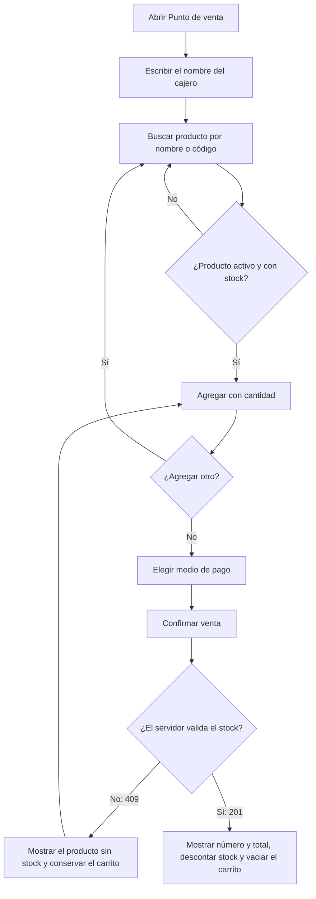

# PRD — SuperVentas: gestión de ventas de un supermercado

| Campo | Valor |
|---|---|
| Producto | SuperVentas (prototipo web) |
| Caso de estudio | Gestión de ventas de un supermercado de barrio |
| Versión del documento | 1.0 (aprobado para MVP) |
| Fecha | 2026-11-21 |
| Asignatura | Fundamentos de Sistemas de Información |

## 1. Problema

> "Como **administrador de un supermercado de barrio**, cuando **cierro el día o el mes**, quiero **saber cuánto vendí, qué productos se mueven, qué se está agotando o venciendo y cómo me pagan mis clientes**, para **decidir qué reponer, qué promocionar y cuánto efectivo debo tener en caja**."

Hoy el supermercado registra las ventas en una caja registradora sin conexión y en cuadernos. Las consecuencias:

- El cierre diario de caja se hace sumando tirillas a mano (≈ 40 min por día).
- No se sabe qué productos o categorías generan más ingresos ni cuál es la utilidad bruta.
- Se agotan productos de alta rotación (arroz, huevos, leche) sin aviso previo.
- Se pierden perecederos porque nadie revisa las fechas de vencimiento.
- No se pueden corregir ventas mal registradas sin perder la trazabilidad.

## 2. Usuarios

| Perfil | Necesidad principal | Frecuencia de uso |
|---|---|---|
| **Cajero(a)** | Registrar ventas rápido y sin errores de precio o de existencias. | Continua durante el turno |
| **Administrador(a)** | Ver indicadores, mantener el catálogo, revisar el historial de ventas y anular ventas erróneas. | Diaria (cierre) y mensual |

En el MVP no hay autenticación: ambos perfiles usan la misma interfaz y el cajero se identifica escribiendo su nombre en cada venta.

## 3. Objetivos del producto y métricas de éxito

| # | Objetivo | Métrica | Meta |
|---|---|---|---|
| O1 | Agilizar el cierre de caja | Tiempo para obtener el total del día por medio de pago | < 1 min (desde el tablero) |
| O2 | Evitar quiebres de stock | Productos de alta rotación agotados por semana | Reducir 50 % |
| O3 | Reducir pérdidas por vencimiento | Unidades vencidas sin vender por mes | Reducir 30 % |
| O4 | Dar visibilidad financiera | Disponibilidad de ventas, IVA y utilidad bruta por periodo | 100 % de los periodos consultables |
| O5 | Integridad de las ventas | Ventas con stock negativo o totales inconsistentes | 0 |

## 4. Alcance

### 4.1 Incluido en el MVP

| Módulo | Propósito |
|---|---|
| **M1. Tablero de ventas** | Resumen ejecutivo del periodo: ventas, IVA, utilidad, ticket promedio, tendencia diaria, categorías, medios de pago, productos top y alertas. |
| **M2. Punto de venta (POS)** | Registrar una venta con varios productos, calcular subtotal, IVA y total, y descontar inventario. |
| **M3. Catálogo de productos** | Consultar, crear, editar y desactivar productos; filtrar por categoría, texto, bajo stock, por vencer y vencidos. |
| **M4. Historial de ventas** | Consultar ventas por rango de fechas, medio de pago y estado; ver el detalle; anular una venta. |

### 4.2 Fuera del alcance (deliberado)

- Facturación electrónica ante la DIAN.
- Pasarelas de pago o datáfonos integrados (el medio de pago solo se **registra**).
- Compras a proveedores y órdenes de compra.
- Contabilidad completa, nómina, fidelización o puntos de clientes.
- Autenticación, roles y auditoría por usuario.
- Devoluciones parciales (solo se anula la venta completa).
- Varias sucursales o bodegas.

Si se incorpora alguno de estos puntos, hay que actualizar este PRD, la SPEC-TECNICA.md y el plan de pruebas.

## 5. Reglas de negocio

| ID | Regla |
|---|---|
| RN01 | Los valores están en pesos colombianos (COP) y los montos mostrados se redondean al peso. |
| RN02 | El `precioVenta` de un producto **no incluye IVA**. El IVA de cada línea = `precioVenta × cantidad × iva%`, redondeado al peso (HALF_UP). |
| RN03 | Las tarifas de IVA permitidas son 0 %, 5 % y 19 %. |
| RN04 | Total de la venta = Σ(subtotal de línea) + Σ(IVA de línea). |
| RN05 | No se puede vender una cantidad mayor al `stockActual` del producto ni un producto inactivo. Si una línea falla, **no se registra ninguna** (transacción atómica). |
| RN06 | Al registrar la venta se descuenta el stock y se congelan el precio, el costo y el IVA de cada línea (no cambian si después se edita el producto). |
| RN07 | Una venta anulada restaura el stock vendido y no se cuenta en los indicadores. Una venta anulada no se puede volver a anular. |
| RN08 | **Bajo stock**: `stockActual ≤ stockMinimo`. |
| RN09 | **Por vencer**: el producto tiene fecha de vencimiento entre hoy y hoy + 7 días (inclusive). **Vencido**: fecha de vencimiento anterior a hoy. |
| RN10 | **Utilidad bruta** = Σ(subtotal sin IVA − costo × cantidad) de las ventas activas del periodo. |
| RN11 | **Ticket promedio** = total vendido / número de ventas activas del periodo (0 si no hay ventas). |
| RN12 | El código de barras es obligatorio y único. `precioVenta` debe ser mayor que 0 y mayor o igual que `precioCompra`. Los stocks no pueden ser negativos. |
| RN13 | Los productos no se borran: se **desactivan** para conservar el historial de ventas. |
| RN14 | Por defecto el tablero muestra el mes en curso. |

## 6. Requisitos funcionales

Prioridad: **M** = imprescindible para el MVP · **D** = deseable · **F** = futuro.

| ID | Requisito | Criterio de aceptación verificable | Prioridad |
|---|---|---|---|
| RF01 | Ver los indicadores del periodo | Para un rango de fechas el tablero muestra: total vendido, número de ventas, ticket promedio, IVA generado y utilidad bruta, y coinciden con la API `/api/dashboard`. | M |
| RF02 | Ver la tendencia diaria de ventas | Hay una barra por día del rango con el total vendido ese día. | M |
| RF03 | Ver las ventas por categoría y por medio de pago | Las sumas por categoría y por medio de pago son iguales al total vendido. | M |
| RF04 | Ver los 5 productos más vendidos | La lista se ordena por unidades vendidas en el periodo, de mayor a menor. | M |
| RF05 | Ver alertas de inventario | El tablero muestra cuántos productos hay con bajo stock, por vencer y vencidos, con un enlace al catálogo filtrado. | M |
| RF06 | Registrar una venta | Se buscan productos por nombre o código, se agregan con cantidad, se ve el total con IVA en vivo y al confirmar la API responde 201 con el número de venta. | M |
| RF07 | Validar el stock en la venta | Si la cantidad supera el stock, la API responde 409 con un mensaje que nombra el producto, y el stock no cambia. | M |
| RF08 | Listar y buscar productos | La tabla muestra código, nombre, categoría, precios, IVA, stock y vencimiento, y filtra por texto y categoría. | M |
| RF09 | Filtrar los productos críticos | Los filtros "Bajo stock", "Por vencer" y "Vencidos" devuelven solo los productos que cumplen RN08 y RN09. | M |
| RF10 | Crear y editar un producto | Un formulario valida RN12 en el cliente y en el servidor; los errores se muestran junto al campo. | M |
| RF11 | Desactivar un producto | Se pide confirmación; el producto deja de aparecer en el POS y sigue en el historial. | M |
| RF12 | Consultar el historial de ventas | Filtra por rango de fechas, medio de pago y estado, y muestra número, fecha, cajero, medio de pago, total y estado. | M |
| RF13 | Ver el detalle de una venta | Muestra cada línea con la cantidad, el precio, el IVA y el total. | M |
| RF14 | Anular una venta | Se pide confirmación; la venta pasa a ANULADA, el stock se restaura y el tablero deja de contarla. | M |
| RF15 | Exportar el historial a CSV | — | D |
| RF16 | Devoluciones parciales y descuentos por promoción | — | F |

## 7. Requisitos no funcionales

| ID | Requisito | Criterio comprobable |
|---|---|---|
| RNF01 | Rendimiento | Con los datos de prueba, cada endpoint responde en < 500 ms en local. |
| RNF02 | Usabilidad | Una venta de 3 productos se registra en ≤ 6 interacciones después de abrir el POS. |
| RNF03 | Retroalimentación | Cada vista muestra un estado de carga, un estado vacío y un mensaje de error de red sin bloquear la interfaz. |
| RNF04 | Diseño adaptable | La interfaz se puede usar sin desplazamiento horizontal de la página entre 375 px y 1920 px de ancho (las tablas pueden desplazarse dentro de su contenedor). |
| RNF05 | Accesibilidad | Contraste del texto ≥ 4.5:1, todos los campos con etiqueta y navegación posible con el teclado. |
| RNF06 | Integridad | Las validaciones de RN05 y RN12 se ejecutan en el servidor; los errores devuelven JSON sin trazas internas. |
| RNF07 | Datos de prueba | El sistema arranca con al menos 20 productos y ventas de los últimos 30 días generadas automáticamente. |
| RNF08 | Persistencia | H2 en memoria: los datos se reinician al reiniciar el backend (decisión temporal del prototipo). |

## 8. Flujos principales

### F1. Registrar una venta (cajero)

### F2. Cierre del día o del mes (administrador)

1. Abre el **Tablero** (por defecto, el mes en curso) o elige el rango de hoy.
2. Lee el total vendido, el número de ventas, el ticket promedio, el IVA y la utilidad.
3. Revisa **ventas por medio de pago** para cuadrar el efectivo de la caja.
4. **Decisión**: si hay alertas de bajo stock o por vencer, entra al catálogo filtrado.
5. **Resultado**: tiene la lista de productos a reponer y de perecederos a promocionar.

### F3. Anular una venta errónea (administrador)

1. Abre el **Historial**, filtra por fecha y localiza la venta.
2. Abre el detalle y pulsa **Anular**.
3. **Decisión**: confirma en el diálogo, o cancela y no pasa nada.
4. **Resultado**: la venta queda ANULADA, se restaura el stock y los indicadores se recalculan.

### F4. Mantener el catálogo (administrador)

1. Abre el **Catálogo** y aplica un filtro (por ejemplo, "Bajo stock").
2. Crea o edita un producto en el formulario.
3. **Decisión**: si la validación falla, se muestran los errores por campo; si es válida, se guarda.
4. **Resultado**: el producto queda disponible en el POS con el nuevo precio o stock.

## 9. Experiencia de usuario

- Una barra lateral fija con 4 entradas: Tablero, Punto de venta, Productos y Ventas (en el móvil se convierte en una barra superior).
- Las tarjetas de indicadores van arriba y los gráficos y tablas debajo.
- Los colores semánticos se usan solo para estados: rojo para vencido o error, ámbar para bajo stock o por vencer, verde para éxito.
- Toda acción destructiva (desactivar, anular) pide confirmación.
- Los montos se muestran con formato `$ 1.234.567`.

## 10. Supuestos y riesgos

- **Supuesto**: los precios de venta se manejan sin IVA y el IVA se suma en la caja. Si el negocio prefiere precios con IVA incluido, hay que cambiar RN02.
- **Riesgo**: sin autenticación, cualquiera puede anular ventas. Es aceptable solo con datos ficticios.
- **Riesgo**: H2 en memoria pierde los datos al reiniciar, así que no sirve para producción.
