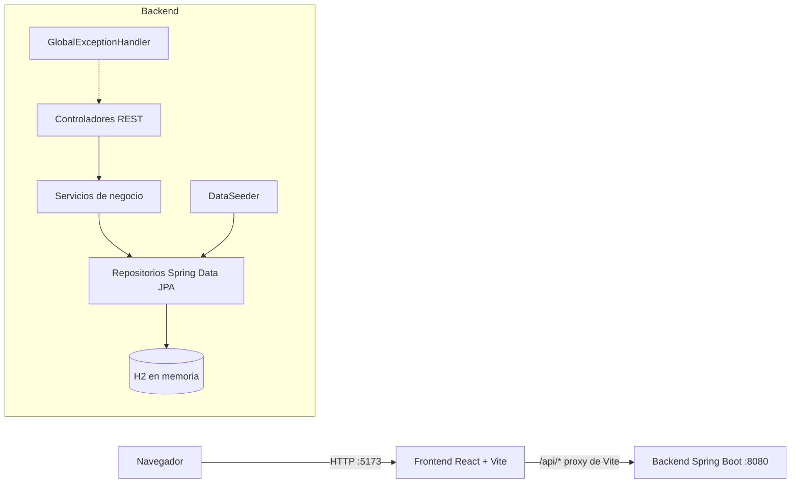
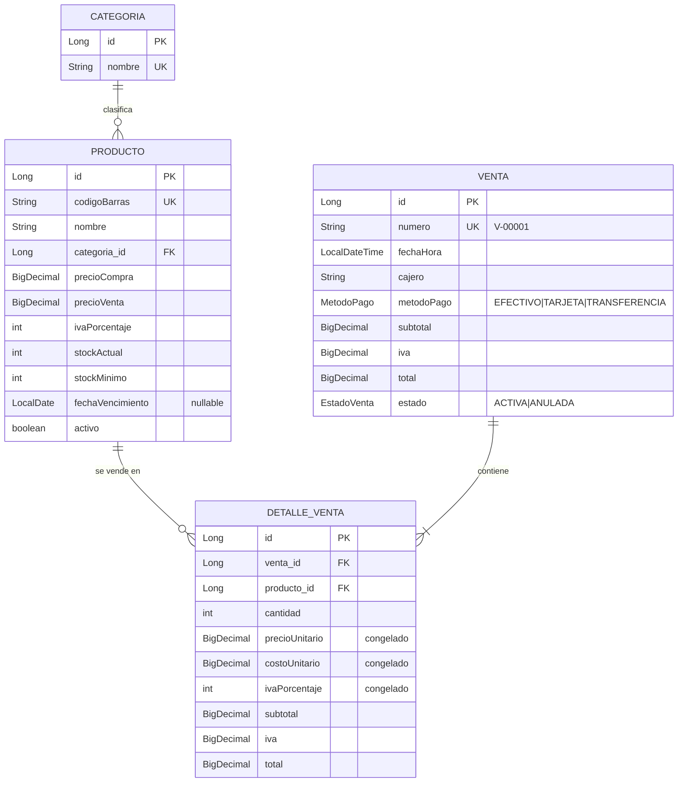

# SPEC-TECNICA — SuperVentas

Especificación técnica derivada de [PRD.md](PRD.md) y [design.md](design.md).

## 1. Arquitectura general



| Componente | Responsabilidad |
|---|---|
| **Frontend** | Presentación, navegación, validación de forma en formularios y estados de carga, vacío y error. No calcula indicadores: los recibe de la API. El carrito del POS calcula una *vista previa* del total, pero el total oficial lo calcula el servidor. |
| **Controladores** (`web`) | Mapear HTTP ↔ DTO, aplicar `@Valid` y devolver los códigos HTTP. No contienen reglas de negocio. |
| **Servicios** (`service`) | Reglas RN02–RN14: cálculo de IVA y totales, validación de stock, anulación, filtros e indicadores. Son transaccionales. |
| **Repositorios** (`repository`) | Acceso a datos con Spring Data JPA y consultas JPQL para filtros y agregados. |
| **DataSeeder** | Carga 6 categorías, 20 productos y ~60 ventas de los últimos 30 días (semilla aleatoria fija, así que los datos son reproducibles). |
| **GlobalExceptionHandler** | Traduce las excepciones a un JSON de error uniforme y oculta las trazas. |

## 2. Stack y versiones

| Capa | Tecnología | Versión configurada |
|---|---|---|
| Lenguaje backend | Java (nivel de compilación `release 21`) | Probado con JDK 26.0.2 |
| Framework | Spring Boot (Web MVC, Data JPA, Validation, H2 console) | 4.2.0 |
| Construcción | Maven Wrapper (`mvnw.cmd`) | Maven 3.10.1 (`.mvn/wrapper/maven-wrapper.properties`) |
| Base de datos | H2 en memoria (`jdbc:h2:mem:superventas`) | La gestiona Spring Boot 4.2.0 |
| Pruebas backend | JUnit 5, Spring Boot Test, MockMvc, AssertJ | Las gestiona Spring Boot 4.2.0 |
| Frontend | React / React DOM | 19.3.1 |
| Enrutamiento | React Router DOM | 7.18.6 |
| Herramienta de desarrollo | Vite (+ @vitejs/plugin-react), oxlint | 8.3.8 |
| Runtime de desarrollo | Node.js / npm | 24.21.0 / 11.19.0 |

> Versiones tomadas de lo que el proyecto instaló realmente (`npm ls`, `pom.xml`, wrapper). Los rangos `^` de `package.json` quedan fijados por `package-lock.json`.

## 3. Modelo de datos



**Restricciones**

- `producto.codigoBarras` es único y no nulo; `categoria.nombre` es único.
- `precioCompra ≥ 0`, `precioVenta > 0` y `precioVenta ≥ precioCompra` (validación de servicio, RN12).
- `ivaPorcentaje ∈ {0, 5, 19}`; `stockActual ≥ 0`, `stockMinimo ≥ 0`.
- `detalle_venta.cantidad ≥ 1`. Una venta tiene al menos 1 detalle.
- Los montos son `DECIMAL(14,2)` y se redondean al peso (escala 0, `HALF_UP`).

## 4. Backend

### 4.1 Paquetes

```
co.edu.tdea.superventas
├── domain        Entidades JPA y enums
├── repository    Interfaces Spring Data JPA
├── service       Lógica de negocio (ProductoService, VentaService, DashboardService)
├── web           Controladores REST
│   └── dto       Records de request/response
├── error         Excepciones de dominio + GlobalExceptionHandler
└── config        DataSeeder, CORS
```

### 4.2 API REST (base `/api`)

| Método | Ruta | Parámetros / cuerpo | Respuesta | Errores |
|---|---|---|---|---|
| GET | `/categorias` | — | `200 [ {id, nombre} ]` | — |
| GET | `/productos` | `q`, `categoriaId`, `filtro` = `BAJO_STOCK` \| `POR_VENCER` \| `VENCIDOS`, `incluirInactivos` (bool, por defecto false) | `200 [ProductoDTO]` | 400 si el filtro no es válido |
| GET | `/productos/{id}` | — | `200 ProductoDTO` | 404 |
| POST | `/productos` | `ProductoRequest` | `201 ProductoDTO` + `Location` | 400 de validación, 409 si el código está duplicado |
| PUT | `/productos/{id}` | `ProductoRequest` | `200 ProductoDTO` | 400, 404, 409 |
| DELETE | `/productos/{id}` | — | `204` (desactivación lógica) | 404 |
| GET | `/ventas` | `desde`, `hasta` (ISO date), `metodoPago`, `estado` | `200 [VentaResumenDTO]` ordenado por fecha descendente | 400 |
| GET | `/ventas/{id}` | — | `200 VentaDTO` (con detalles) | 404 |
| POST | `/ventas` | `{cajero, metodoPago, items:[{productoId, cantidad}]}` | `201 VentaDTO` | 400, 404 si el producto no existe, 409 si no hay stock o el producto está inactivo |
| POST | `/ventas/{id}/anular` | — | `200 VentaDTO` | 404, 409 si ya está anulada |
| GET | `/dashboard` | `desde`, `hasta` (por defecto, el mes en curso) | `200 DashboardDTO` | 400 si desde > hasta |

**ProductoDTO**: `id, codigoBarras, nombre, categoriaId, categoriaNombre, precioCompra, precioVenta, ivaPorcentaje, stockActual, stockMinimo, fechaVencimiento, activo, bajoStock, porVencer, vencido`.

**DashboardDTO**: `desde, hasta, totalVentas, subtotal, iva, utilidadBruta, numeroVentas, ticketPromedio, ventasPorDia[{fecha,total}], ventasPorCategoria[{nombre,total}], ventasPorMetodoPago[{nombre,total,cantidad}], topProductos[{productoId,nombre,unidades,total}], alertas{bajoStock,porVencer,vencidos}`.

**Formato de error** (todos los errores):

```json
{ "timestamp": "2026-11-21T10:00:00", "status": 409, "error": "Conflict",
  "message": "Stock insuficiente para 'Arroz Diana 500 g': disponible 3, solicitado 5",
  "fields": { "precioVenta": "debe ser mayor que 0" } }
```

`fields` solo aparece en los errores de validación (400). Los errores 500 devuelven un mensaje genérico, sin traza.

### 4.3 Configuración (`application.properties`)

- `server.port=8080`
- `spring.datasource.url=jdbc:h2:mem:superventas;DB_CLOSE_DELAY=-1`, usuario `sa` y contraseña vacía (solo para desarrollo).
- `spring.jpa.hibernate.ddl-auto=create-drop`, `spring.jpa.open-in-view=false`.
- `spring.h2.console.enabled=true` en `/h2-console` (solo en desarrollo; **desactivarla en producción**).
- CORS permitido para `http://localhost:5173` (además, el frontend usa el proxy de Vite).

## 5. Frontend

```
frontend/src
├── api/client.js          fetch + manejo de errores (ApiError con status, message y fields)
├── api/*.js               productosApi, ventasApi, dashboardApi, categoriasApi
├── components/            Layout, KpiCard, BarChart, StatusBadge, ConfirmDialog,
│                          AsyncState (carga/vacío/error), ProductoForm
├── pages/                 DashboardPage, PosPage, ProductosPage, VentasPage
├── utils/format.js        Formato COP y fechas
└── main.jsx / App.jsx     Router
```

- Los servicios de API están separados de los componentes de presentación.
- El proxy de Vite manda `/api` → `http://localhost:8080`.
- Los gráficos son barras hechas con CSS, sin librerías externas.

## 6. Plan de pruebas

| Tipo | Herramienta | Cobertura |
|---|---|---|
| Unitarias/integración del backend | JUnit 5 + Spring Boot Test + MockMvc | Cálculo de IVA y totales, stock insuficiente (409), anulación que restaura el stock, doble anulación (409), validación de producto (400), filtros de productos, indicadores del tablero |
| API manual | `Invoke-RestMethod` / navegador | GET de cada recurso y POST de una venta |
| Funcional de la interfaz | Navegador | Matriz P01–P10 de [PRUEBAS.md](PRUEBAS.md) |

## 7. Fases de implementación y criterios de finalización

| Fase | Entregable | Criterio de finalización |
|---|---|---|
| 1 | Dominio, repositorios y seeder | La app arranca y `/h2-console` muestra 20 productos |
| 2 | Servicios y controladores | `mvnw.cmd test` en verde |
| 3 | Frontend: layout, catálogo y historial | Las tablas muestran datos reales de la API |
| 4 | Frontend: POS y tablero | Una venta registrada se refleja en el tablero |
| 5 | Pruebas y documentación | PRUEBAS.md con resultados reales y README reproducible |
